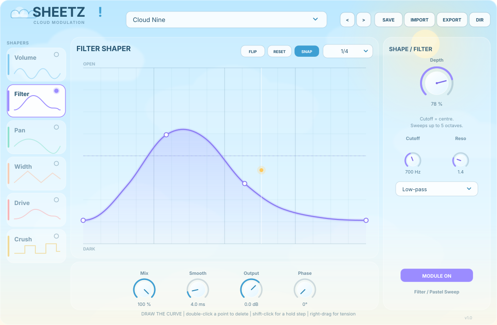

# SHEETZ!

**A cloud-themed modulation shaper for your DAW.** Draw a curve, hear it move.

SHEETZ! is a VST3 + standalone audio effect inspired by the hands-on curve editing of
ShaperBox, rebuilt around a brighter, simpler workflow. Six shapers share one drawable
modulation curve system, 16 factory presets cover the usual production jobs, and user
presets are plain JSON files you can read, edit, back up and share.



> The image above is an illustration of the interface, not a screenshot from a running build.

---

## What it does

| Shaper | What the curve controls |
| --- | --- |
| **Volume** | Gain, from silence to unity. Great for tremolo, gating and ducking. |
| **Filter** | A resonant low-pass / band-pass / high-pass sweep, up to five octaves around the cutoff. |
| **Pan** | Stereo position, from hard left to hard right. |
| **Width** | Side-signal width, from mono to extra wide. |
| **Drive** | Saturation amount with a tone control on the output. |
| **Crush** | Bit-depth and sample-rate reduction. |

Every shaper has its own curve, depth and on/off switch. All curves run from the same
tempo-synced clock, so layered movement stays locked to the beat.

### Curve editing

- **Draw** directly in the large curve area.
- **Add** a point by clicking an empty part of the curve.
- **Move** a point by dragging it.
- **Delete** a point by double-clicking it.
- **Hold / step** a value by shift-clicking a point (the curve holds that value until
  the next point).
- **Tension** by right-dragging (or alt-dragging) vertically over a curve segment.
- **Snap** to the 16th-note / 8-step grid with the SNAP button.
- **RESET** returns the curve to its neutral shape; **FLIP** mirrors it upside down.

The playhead shows where the modulation is right now, and the mini curve preview on each
module card shows that module's curve at a glance.

### Global controls

- **Rate** — 4 bars down to 1/32, plus dotted and triplet values.
- **Phase** — rotate the modulation start point from 0° to 360°.
- **Smooth** — one-pole smoothing from instant to 50 ms.
- **Mix** — blend the shaped signal with the dry signal.
- **Output** — final gain trim from -24 dB to +12 dB.

---

## Presets

### Factory presets (16)

| Category | Presets |
| --- | --- |
| Tremolo | Cloud Nine, Air Tremolo, Heaven Gate, Lullaby |
| Ducking | Sidechain Sky |
| Filter | Pastel Sweep, Raindrop Pluck, Cumulus Wah |
| Motion | Breeze Pan, Skyline Width, Marshmallow Swell |
| Texture | Thunder Drive, Pixel Rain, Static Halo |
| Signature | Cloudburst, Golden Hour |

### User presets

- **SAVE** writes the current sound to the user preset folder.
- **IMPORT** accepts `.sheetz`, `.json`, legacy `.shz` and XML preset files.
- **EXPORT** writes a portable `.sheetz` file wherever you choose.
- You can also **drag and drop** preset files onto the plugin window.
- **DIR** opens the preset folder in your file manager.

User presets live here:

| Platform | Folder |
| --- | --- |
| Windows | `Documents\SHEETZ!\Presets` |
| macOS | `~/Documents/SHEETZ!/Presets` |
| Linux | `~/Documents/SHEETZ!/Presets` |

A `.sheetz` file is readable JSON. Values in `params` are the real displayed values
(not normalised), and curves use `x`/`y` in the 0–1 range:

```json
{
  "format": "SHEETZ_PRESET",
  "version": 1,
  "name": "My Cloud",
  "category": "User",
  "author": "SHEETZ!",
  "params": {
    "rate": 4,
    "smooth": 4,
    "mix": 100,
    "volume_on": 1,
    "volume_depth": 55
  },
  "curves": {
    "volume": [
      { "x": 0.0, "y": 0.2, "t": 0.0, "hold": false },
      { "x": 0.5, "y": 1.0, "t": 0.0, "hold": false },
      { "x": 1.0, "y": 0.2, "t": 0.0, "hold": false }
    ]
  }
}
```

Curve fields: `x` and `y` are 0–1, `t` is tension from -1 to +1, and `hold` creates a
step. Modules that are missing from `curves` are reset to their neutral shape.

---

## Install a build

1. Open the **Actions** tab and pick the latest successful **Build** run.
2. Download the artifact for your platform.
3. Copy the `.vst3` into your VST3 folder:
   - **Windows:** `C:\Program Files\Common Files\VST3\`
   - **macOS:** `~/Library/Audio/Plug-Ins/VST3/`
   - **Linux:** `~/.vst3/`
4. Rescan plugins in your DAW. The standalone build can be launched directly for testing.

The CI builds are unsigned. On macOS, if Gatekeeper blocks the plugin, right-click the
`.vst3` and choose **Open**, or remove the quarantine flag with
`xattr -dr com.apple.quarantine /path/to/SHEETZ!.vst3`. On Windows, SmartScreen may show
a warning for the unsigned standalone executable.

---

## Build from source

### Requirements

- CMake 3.22 or newer
- A C++17 compiler (Visual Studio 2022, Xcode 15+, or GCC/Clang)
- Git and an internet connection for the first configure
- Linux only: the usual JUCE desktop packages

JUCE 8.0.8 is downloaded automatically with CMake `FetchContent`; you do not need a
separate JUCE checkout.

The clone commands below use `YOUR-GITHUB-USERNAME` as a placeholder. Replace it with the
account or organisation that hosts the repository, or copy the HTTPS URL from your
repository page.

You can also use the bundled CMake presets:

```bash
cmake --preset release
cmake --build --preset release
```

### Windows

```powershell
git clone https://github.com/YOUR-GITHUB-USERNAME/SHEETZ.git
cd SHEETZ
cmake -S . -B build
cmake --build build --config Release --target SHEETZ_VST3 SHEETZ_Standalone --parallel
```

### macOS

```bash
git clone https://github.com/YOUR-GITHUB-USERNAME/SHEETZ.git
cd SHEETZ
cmake -S . -B build -DCMAKE_BUILD_TYPE=Release
cmake --build build --config Release --target SHEETZ_VST3 SHEETZ_Standalone --parallel
```

For a universal binary add `-DCMAKE_OSX_ARCHITECTURES="arm64;x86_64"` to the configure
command.

### Linux (Ubuntu / Debian)

```bash
sudo apt-get install build-essential libasound2-dev libx11-dev libxext-dev \
  libxinerama-dev libxrandr-dev libxcursor-dev libxcomposite-dev \
  libfreetype6-dev libfontconfig1-dev libgl1-mesa-dev libglu1-mesa-dev \
  libxrender-dev mesa-common-dev pkg-config

git clone https://github.com/YOUR-GITHUB-USERNAME/SHEETZ.git
cd SHEETZ
cmake -S . -B build -DCMAKE_BUILD_TYPE=Release
cmake --build build --config Release --target SHEETZ_VST3 SHEETZ_Standalone --parallel
```

### Where the binaries land

With a multi-config generator (Visual Studio, Xcode) look in:

```
build/SHEETZ_artefacts/Release/VST3/SHEETZ!.vst3
build/SHEETZ_artefacts/Release/Standalone/SHEETZ!.exe   (or .app / binary)
```

Single-config generators (Makefiles, Ninja) omit the `Release` directory, so the files
are under `build/SHEETZ_artefacts/`.

To copy the VST3 into your system folder during the build, change
`COPY_PLUGIN_AFTER_BUILD` to `TRUE` in `CMakeLists.txt`.

---

## Publish your own copy

This folder is already a complete repository payload: source, CMake build, CI workflow,
licence and documentation. To publish it from a machine with Git installed:

```bash
git init -b main
git add .
git commit -m "Initial SHEETZ! implementation"
git remote add origin https://github.com/YOUR-GITHUB-USERNAME/SHEETZ.git
git push -u origin main
```

Create the empty `SHEETZ` repository on GitHub first, without adding a README, licence
or `.gitignore` there. See [docs/PUBLISHING.md](docs/PUBLISHING.md) for the browser-only
upload route and the GitHub CLI commands.

---

## Continuous integration

`.github/workflows/build.yml` builds the VST3 and standalone on every push and pull
request:

- Windows x64 (MSVC)
- macOS universal (arm64 + x86_64)
- Linux x64

Each job uploads a zipped artifact named `SHEETZ-<platform>`, so you can download a
ready-to-install build without a local compiler.

---

## Project layout

```
CMakeLists.txt              JUCE fetch, plugin target and build settings
CMakePresets.json           Release configure/build shortcuts
Source/
  Modules.h                 Shaper order, IDs, names and neutral values
  Curve.h / Curve.cpp       Breakpoint curve + lock-free bake table
  PluginProcessor.*         DSP, parameters, state and preset import/export
  PluginEditor.*            Window layout, clouds, preset browser
  CurveEditor.*             Large curve editor
  ModuleButton.*            Shaper cards with mini curve previews
  CloudsLookAndFeel.*       Sky palette, knobs, buttons and combo boxes
  FactoryPresets.*          The 16 factory sounds
docs/ui-preview.svg         Interface illustration used by this README
docs/PUBLISHING.md          Git and browser-only GitHub upload notes
.github/workflows/build.yml CI build matrix
```

---

## Controls cheat sheet

| Action | Gesture |
| --- | --- |
| Select a shaper | Click its card in the SHAPERS rail |
| Bypass a shaper | Click the power dot on its card |
| Add a curve point | Click an empty spot in the curve |
| Move a point | Drag it |
| Delete a point | Double-click it |
| Hold / step | Shift-click a point |
| Change tension | Right-drag (or Alt-drag) vertically over a segment |
| Temporarily bypass snapping | Hold Shift while dragging |

---

## License

SHEETZ! source code is released under the **GNU Affero General Public License v3.0**
(AGPL-3.0). See [LICENSE](LICENSE).

This project uses [JUCE](https://juce.com), which is dual-licensed under the AGPLv3 and
a commercial JUCE licence. If you distribute a proprietary plugin based on this code,
you need an appropriate JUCE commercial licence and must comply with the AGPL for the
parts of this project you redistribute, or replace the JUCE-dependent code with an
alternative that fits your licence.

"VST" is a trademark of Steinberg Media Technologies GmbH.
